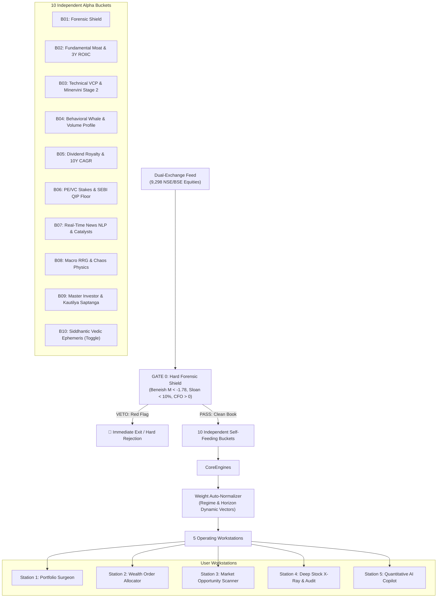

# AURELIUS APEX (AQ-OS v9.0)
### Autonomous Quantitative Wealth Operating System for Indian Equities (NSE & BSE)

> **PRIME DIRECTIVE: "WIN IS MAIN"**  
> Systematic, all-weather alpha generation and compound wealth creation across Indian capital markets with strict capital preservation through non-negotiable forensic vetoes.

---

## 🏛️ System Architecture

AURELIUS APEX is an institutional-grade, multi-paradigm quantitative operating system designed for the Indian equities landscape. It seamlessly integrates 10 independent self-feeding engine buckets across 300 core mathematical equations and 3,000+ multi-horizon market, tick, forensic, macro, and astro sub-signals.



---

## ⚡ The 5 Operating Workstations

1. **Station 1: Portfolio Surgeon & Rebalance Engine**
   - 4 Flexible Input Methods: Broker CSV/XLSX, Smart Text Parser, Quick Add, and Interactive Grid Editor.
   - ACAR Split Reconciliation (adjusts historic splits like Kotak Bank 1:5 automatically).
   - Generates surgical **Alpha Replacement Switches** (e.g. exiting stagnant laggards into high-velocity breakout compounders) with real capital reallocation and tax reserve estimation.

2. **Station 2: Capital Allocator & Order Builder**
   - Computes exact **integer share quantities** based on total deployment capital.
   - Enforces risk-governed stop losses and multi-target price objectives across 4 asset tiers.
   - Includes sovereign hedging buffers (`GOLDBEES`, `LIQUIDBEES`).

3. **Station 3: Full-Market Opportunity Scanner**
   - Scans the market across **8 Alpha Lenses**:
     - *All-Weather Sovereign Moats*
     - *Minervini Stage-2 VCP Breakouts*
     - *3-Year ROIIC & Capex Jolt Leaders*
     - *SEBI QIP Floor Arbitrage*
     - *Dividend Aristocrats & Cash Compounds*
     - *Whale Accumulation (VPIN & Volume Profile POC)*
     - *High-Catalyst News Momentum*
     - *Siddhantic Jyotish High-Harmonic Confluence*

4. **Station 4: Stock X-Ray & 10-Engine Diagnostic Audit**
   - Starts with a clean, unselected input (`index=None`).
   - Autocomplete search over **9,298 listed equities across both NSE and BSE**.
   - Generates full 10-bucket radar breakdown, 8-ratio Beneish M-Score table, Sloan accruals, DuPont ROE, and downloadable 6-sheet institutional Excel dossier.

5. **Station 5: Aurelius Quantitative Copilot**
   - Real-time quantitative conversational interface answering diagnostic, structural, and allocation questions with mathematical precision.

---

## 🌐 Dual-Exchange Universe (NSE + BSE)

AURELIUS APEX operates natively across both Indian exchanges with universal ticker resolution:
- **NSE Equities**: 2,629+ listed companies (`SYMBOL.NS`).
- **BSE Equities**: 4,374+ listed companies (`SYMBOL.BO`).
- **6-Digit BSE Scrip Codes**: Numeric lookup (e.g., `500020` $\rightarrow$ `BOMDYEING.BO`, `500325` $\rightarrow$ `RELIANCE.BO`).
- **2,257+ BSE-Exclusive Companies**: Automatically detected and routed to `.BO` without manual prefixing.

---

## 🚀 Quickstart & Local Installation

### Prerequisites
- Python 3.10, 3.11, or 3.12
- Recommended: Virtual Environment (`venv` or `uv`)

### 1. Clone & Setup
```bash
git clone https://github.com/<your-username>/<your-repo-name>.git
cd <your-repo-name>
python -m venv .venv
# Windows:
.\.venv\Scripts\activate
# Linux/macOS:
source .venv/bin/activate
```

### 2. Install Dependencies
```bash
pip install -r requirements.txt
```

### 3. Verify All 12 Stages
```bash
python verify_maha_chakra.py
```

### 4. Launch Operating System
```bash
streamlit run app.py
```
Open [http://localhost:8501](http://localhost:8501) in your browser.

---

## ☁️ Streamlit Cloud 1-Click Deployment

1. Push this repository to GitHub.
2. Go to [share.streamlit.io](https://share.streamlit.io).
3. Connect your GitHub repository.
4. Set **Main file path** to `app.py`.
5. Click **Deploy**.

---

## 🔒 Security & Verification

- **Zero Static Placeholders**: Real multi-year financial statements parsed on-demand from balance sheets, income statements, and cash flows.
- **Bytecode Verification**: Run `python protect_ip.py` to validate module integrity and compile bytecode (`.pyc`).
- **Audit Verification**: `python verify_maha_chakra.py` validates all 12 quantitative subsystems end-to-end.

---
*AURELIUS APEX (AQ-OS v9.0) — Designed for Sovereign Compounding.*
